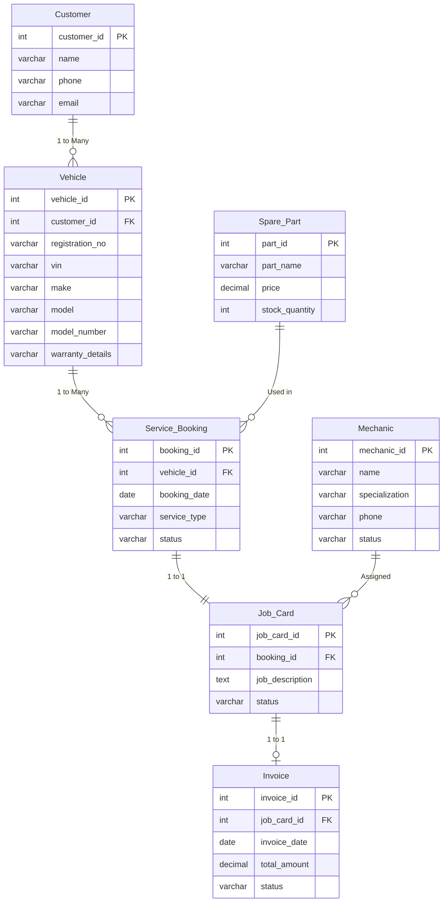

# AutoCare Precision · Vehicle Service Centre Management System (V1)
### Universal Multi-Brand Automotive Workshop Portal (College DBMS Project)

A complete, high-performance web application built for a college DBMS project. Designed with an ultra-clean **precision automotive layout**, featuring modern typography, high-contrast imagery, and full CRUD operations directly backed by **MySQL 8.0**.

---

## 1. Quick Start: One-Click Launcher

To run the entire system in **one click**:

👉 Double-click **`run_app.bat`** (or **`start.bat`**) in the project folder.

### What the batch file does automatically:
1. Verifies Python 3 is installed in your system PATH.
2. Checks and installs required dependencies (`Flask`, `mysql-connector-python`, `python-dotenv`).
3. Tests connection to MySQL Server on `127.0.0.1:3306` with database `vehicle_service_centre`.
4. Automatically opens your default web browser to **`http://127.0.0.1:5000`**.
5. Starts the Flask web server with live auto-reloading enabled.

---

## 2. Technology Stack

- **Backend Framework:** Python 3 + Flask
- **Database Engine:** MySQL 8.0 (`vehicle_service_centre`)
- **Database Connector:** `mysql-connector-python` (parameterized queries, zero SQL injection)
- **Frontend / UI:** HTML5, CSS3, Bootstrap 5.3, Bootstrap Icons
- **Design Aesthetic:** High-contrast precision automotive styling (Deep black `#000000`, crisp white `#FFFFFF`, clean borders, license plate badges, and responsive tables)
- **Multi-Brand Fleet Coverage:** Hyundai, Toyota, Honda, Tata, Mahindra, Maruti Suzuki, BMW, Porsche, Mercedes-Benz, Audi, and more.

---

## 3. Core Features

1. **Multi-Brand Workshop Command Hero:**
   - Universal automotive facility hero with instant **17-digit VIN & Registration Number Lookup**.
   - Direct quick-action buttons: *+ Customer*, *+ Vehicle & VIN*, *+ Booking*, *+ Job Card*, *+ Part*, *+ Invoice*, *+ Technician*.
2. **Vehicle Dossier & Previous Service History (`/vehicle/<id>`):**
   - **VIN Slot:** Permanent 17-character chassis number tracking.
   - **Model Number / Specification:** Engine and trim variant tags (e.g. `SX(O) 1.5 Turbo DCT`, `2.8 4x4 AT`, `740Li G70`).
   - **Warranty Details:** Active factory and extended warranty tracking.
   - **Chronological Service History Table:** Multi-table SQL `JOIN` combining Service Bookings, Mechanic Job Card Diagnostic Notes, and Billing Invoices.
3. **Full CRUD on All Entities:**
   - Complete Create, Read, Update, and Delete operations on Customers, Vehicles, Bookings, Job Cards, Technicians, Spare Parts, and Invoices.
   - **Foreign Key Protection:** Prevents accidental deletion of customers or vehicles with active dependencies.
4. **Inventory & Low-Stock Alerts:**
   - Automatic low-stock warnings for spare parts with $\le 5$ units.
5. **Interactive Viva / Presentation CLI (`python crud_demo.py`):**
   - Terminal demonstration suite showing live SQL queries with parameter substitution and an interactive direct SQL console.

---

## 4. Database Schema (MySQL 8)

The application manages 7 interconnected tables with relational constraints:



---

## 5. Manual Setup & Running Instructions

### Step 1: Install Dependencies
```bash
pip install -r requirements.txt
```

### Step 2: Database Configuration
Ensure `.env` contains your MySQL credentials:
```ini
DB_HOST=127.0.0.1
DB_PORT=3306
DB_USER=root
DB_PASSWORD=1234
DB_NAME=vehicle_service_centre
SECRET_KEY=autocare-vscms-secret-key-college-dbms-2026
```

### Step 3: Run Database Health Check / Migration
```bash
python setup_db.py
```

### Step 4: Run Automated Test Suite
```bash
python test_app.py
```

### Step 5: Start the Server Manually
```bash
python app.py
```
Open **`http://127.0.0.1:5000`** in any web browser.

### Step 6: Run Interactive CRUD Demonstration
```bash
python crud_demo.py
```
